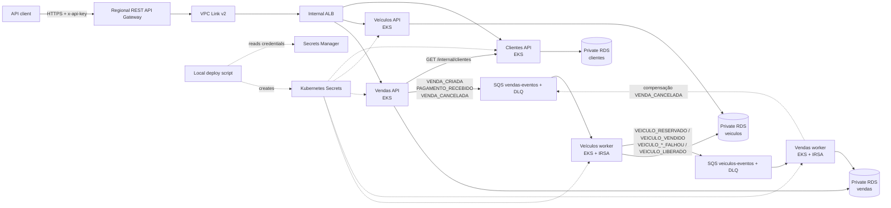

# SOAT13 Revenda - EKS, ECR and API Gateway

Terraform and Kubernetes deployment for the Clientes, Veiculos, and Vendas
microservices. The stack creates a VPC, private EKS workers, ECR repositories,
an internal ALB ingress, and a public REST API Gateway connected through the
existing VPC Link v2.
The RDS stack is maintained in `soat13-tc-revenda-infra-db`.

## Architecture



The API Gateway is the public application entry point. The ALB, EKS workers,
databases, and SQS worker are in private network paths. This is not a fully
serverless design: EKS worker nodes are EC2 instances selected to run the
existing long-lived HTTP services and worker containers.

## Security and cost

- Use the local AWS CLI `default` profile from `~/.aws/credentials`; do not
  commit credentials to this repository.
- Set `kubectl_cidr_allowlist` to a trusted public IP CIDR. Do not use
  `0.0.0.0/0`.
- RDS and the ALB are private. The public REST API requires a shared API key in
  the `x-api-key` header and applies a 10 requests/second, 20-request burst
  throttle. An API key is a shared bearer secret, not individual identity or
  strong authentication. The key is sensitive Terraform output and is present
  in Terraform state; protect the state backend and rotate the key if exposed.
- The EKS API has public and private endpoints; public access is restricted by
  `kubectl_cidr_allowlist`. Keep this list to trusted addresses. EKS API,
  audit, and authenticator control-plane logs are enabled.
- RDS storage and SQS queues use encryption at rest. RDS credentials are
  generated and stored by Secrets Manager. The deployment script copies them
  into Kubernetes Secrets; this Terraform configuration does not enable EKS
  envelope encryption for Kubernetes Secrets. Restrict EKS RBAC and plan
  encryption at rest or Secrets Store CSI integration.
- The `vendas` and `veiculos` ServiceAccounts use separate IRSA roles: each one
  may only publish to its own events queue and consume the other service's
  events queue. No static AWS credentials are needed. Standard SQS delivery is at least once, so consumers must
  tolerate duplicate messages.
- The API key is the only public API access control currently configured.
  There is no per-user identity, AWS WAF, or application-level authorization
  policy in this stack. The API Gateway backend connection to the internal ALB
  currently uses HTTP inside the VPC.
- The default stack creates two `t3.medium` EKS workers, an EKS control plane,
  an internal ALB, a NAT Gateway, three RDS instances, ECR, and API Gateway.
  These resources incur ongoing AWS charges. Review the current regional AWS
  pricing and quotas before applying.
- The deployment identity needs access to Secrets Manager to read the generated
  database credentials, in addition to the permissions required by Terraform,
  EKS, ECR, RDS, and API Gateway. It must also be allowed to read the
  `AWSServiceRoleForAmazonEKSNodegroup` IAM role.
  - The deployment identity also needs permission to manage SQS queues and the
    worker IAM role/policy. The worker accesses the queue through a narrowly
    scoped IRSA role; do not add AWS credentials to Kubernetes secrets. Grant the
    deployment identity `sqs:CreateQueue`, `DeleteQueue`, `GetQueueAttributes`,
    `GetQueueUrl`, `ListQueueTags`, `SetQueueAttributes`, `TagQueue`, and
    `UntagQueue` on
    `arn:aws:sqs:${AWS_REGION}:${AWS_ACCOUNT_ID}:soat13-tc-revenda-vendas-eventos*`
    and `arn:aws:sqs:${AWS_REGION}:${AWS_ACCOUNT_ID}:soat13-tc-revenda-veiculos-eventos*`
    (each queue and its `-dlq`), plus IAM permissions for the
    `soat13-tc-revenda-vendas-sqs` and `soat13-tc-revenda-veiculos-sqs` roles.
- Terraform state contains sensitive infrastructure values. Use the private,
  encrypted, versioned S3 bucket created by `scripts/bootstrap-state.sh`.

## Prerequisites

AWS CLI, Terraform >= 1.9, Docker, `kubectl`, Python 3, `curl`, and access to the
AWS Load Balancer Controller Helm chart. Configure the local `default` AWS CLI
profile in `~/.aws/credentials`; never commit its credentials.

```sh
export AWS_PROFILE=default
export AWS_REGION=us-east-1
export TF_STATE_BUCKET='your-globally-unique-state-bucket'
export KUBECTL_CIDR_ALLOWLIST='YOUR_PUBLIC_IP/32'
bash scripts/bootstrap-state.sh
bash scripts/deploy.sh
```

For an already-deployed stack, set `LOAD_BALANCER_LISTENER_ARN` to the current
internal ALB listener ARN before running the deploy script. This keeps the
existing API Gateway and API key in place during the initial Terraform apply.

The deploy script applies EKS/ECR, creates the private database tier, builds and
pushes the three application images, initializes each RDS schema using the
service's `database/init.sql`, applies Kubernetes resources, discovers
the internal ALB listener, and connects API Gateway. Supply the service source
directories through `CLIENTES_DIR`, `VEICULOS_DIR`, and `VENDAS_DIR` when they
are not adjacent to this repository. RDS generates and manages a separate
master credential for each database in AWS Secrets Manager; the deploy script
reads them to initialize the schemas and Kubernetes secrets without printing
them. Restrict access to the encrypted state bucket and the Secrets Manager
secrets. Do not put credentials in `terraform.tfvars`.

### Saga coreografada (vendas ↔ veículos)

The sale flow is a **choreographed Saga**: there is no central coordinator.
Each service runs its local transaction, publishes a domain event to its own
SQS standard queue, and reacts to the other service's events.

| Queue | Producer | Consumer | Events |
|-------|----------|----------|--------|
| `soat13-tc-revenda-vendas-eventos` | Vendas API / worker | `veiculos-worker` | `VENDA_CRIADA`, `PAGAMENTO_RECEBIDO`, `VENDA_CANCELADA` |
| `soat13-tc-revenda-veiculos-eventos` | `veiculos-worker` | `vendas-worker` | `VEICULO_RESERVADO`, `VEICULO_RESERVA_FALHOU`, `VEICULO_VENDIDO`, `VEICULO_VENDA_FALHOU`, `VEICULO_LIBERADO` |

Reservation and payment-confirmation requests return `202 Accepted` with a sale
code and `statusUrl`; use `GET /api/vendas/{codigo}` to check completion.
Compensations are events too: cancelling a sale publishes `VENDA_CANCELADA`,
which makes Veículos release the reservation. Consumers are idempotent (the
vehicle stores the code of the sale that owns its reservation), permanent
failures become `*_FALHOU` events, and retryable failures are retried up to five
receives before going to each queue's DLQ. On the last attempt the vehicles
worker publishes the failure event so the sale does not wait forever.

Migration from the previous command queue is done in two steps so a failed
apply never breaks the running services:

1. Deploy this version. `legacy-vendas-queue.tf` keeps the old
   `soat13-tc-revenda-vendas` queue (and its DLQ) while the events queues are
   created and the applications are switched over. The IRSA role of Vendas is
   kept through `moved` blocks.
2. After the new workers are running and the old queue is empty, delete
   `legacy-vendas-queue.tf` and deploy again to remove the old queue.

The deployment identity must be allowed to create the new queues (see the
permissions above) before step 1; otherwise Terraform stops with
`AccessDenied` on `sqs:CreateQueue`.

The deployment uses two Terraform applies for the API Gateway because the
internal ALB listener is created by the Kubernetes ingress controller after
the first EKS apply.

## Production smoke test

After deployment, retrieve the URL and key from Terraform outputs. The key is
marked sensitive and stored in the encrypted Terraform state; do not print it
or commit it. The smoke test confirms that a request without a key is rejected,
checks the CORS preflight, then sends read-only requests with the `x-api-key` header.
Response bodies are not printed.

```sh
export AWS_PROFILE=default
export API_BASE_URL="$(terraform output -raw api_gateway_url)"
export API_KEY="$(terraform output -raw api_gateway_api_key)"
bash scripts/smoke-test.sh
```

The smoke test sends read-only GET requests to the health, customer, available
vehicle, and sales-list endpoints. For a manual request:

```sh
curl -i -H "x-api-key: $API_KEY" "$API_BASE_URL/api/health"
```

## Repositories and report

- [Clientes](https://github.com/mgustavocoder/soat13-tc-revenda-clientes)
- [Veículos](https://github.com/mgustavocoder/soat13-tc-revenda-veiculos)
- [Vendas](https://github.com/mgustavocoder/soat13-tc-revenda-vendas)
- [Infraestrutura de banco](https://github.com/mgustavocoder/soat13-tc-revenda-infra-db)
- [Arquitetura, segurança e Saga (PDF)](docs/arquitetura-seguranca-saga.pdf)
